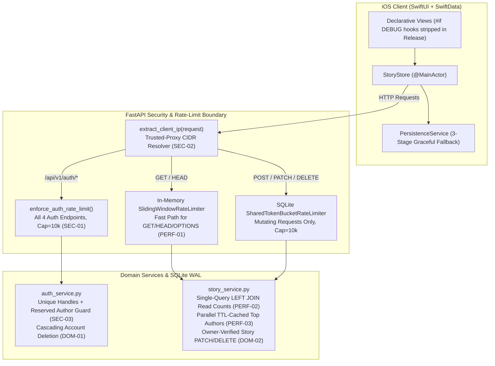

# Feature Plan 06: Security Vulnerabilities & Architectural Remediation Plan

**Document Version:** 2.0.0
**Architectural Scope:** Authentication Hardening, SQLite Concurrency & Query Optimization, Content/Account Lifecycle Completion, iOS State Resilience
**Backend Stack:** Python 3.9+ / FastAPI / Pydantic v2 / SQLite (WAL)
**Client Stack:** Swift 5.9+ / SwiftUI / SwiftData
**Related Context:** [`docs/AGENT_HANDOFF_CONTEXT.md`](../AGENT_HANDOFF_CONTEXT.md), [`docs/adr/0002-ios-open-source-literature-focus-and-manga-feature-flag.md`](../adr/0002-ios-open-source-literature-focus-and-manga-feature-flag.md)

---

## 1. Executive Summary & Audit Scope

Following the strategic decision to focus **Fable iOS** exclusively on open-source books, classic fables, and community manuscripts (`StoryStore.isMangaEnabled = false`), a full-stack security and architectural audit was conducted across the FastAPI backend (`backend/`) and the native iOS client (`frontend/FableApp/`).

This document records all **non-manga security vulnerabilities**, **database/backend scalability bottlenecks**, **incomplete domain lifecycle planning**, and **iOS client architectural flaws**, paired with a 4-phase engineering remediation plan, architecture diagrams, and exact code specifications.

---

## 2. Vulnerability & Architectural Deficit Matrix

| ID | Category | Severity | Component / File | Finding Summary |
|---|---|---|---|---|
| **SEC-01** | Auth Rate Limiting & DoS | **P0 (High)** | `backend/api/v1/endpoints/auth.py`<br>`backend/services/auth_rate_limit.py` | `POST /api/v1/auth/password-reset/confirm` lacks `enforce_auth_rate_limit()`. Each call acquires a `BEGIN IMMEDIATE` SQLite write lock and runs 600,000 PBKDF2-HMAC-SHA256 iterations on match. Additionally, `auth_rate_limits` has no maximum row cap. |
| **SEC-02** | Reverse-Proxy IP Collapse | **P0 (High)** | `backend/api/v1/endpoints/auth.py`<br>`backend/core/rate_limit.py` | `/auth/register`, `/auth/login`, and `/auth/password-reset/request` pass `request.client.host` directly instead of the trusted-proxy-aware IP extractor. Behind Nginx/Caddy/Docker, all users share the proxy IP, so 5 registrations in 15 minutes locks out all new registrations globally. |
| **SEC-03** | Author Impersonation & Handle Collisions | **P0 (High)** | `backend/core/database.py`<br>`backend/services/auth_service.py`<br>`StoryStore.swift` | `users.handle` lacks a `UNIQUE` constraint. Worse, `POST /api/v1/stories` copies `user.name` into `stories.author` and `StoryStore.matchesAuthor` matches by plain string name—allowing any user to rename themselves `"Aesop"` or `"Jane Austen"` and inject stories into official catalog author pages. |
| **SEC-04** | Release Binary Test Hooks | **P0 (Medium)** | `ContentView.swift`<br>`LibraryView.swift` | Simulator automation hooks (`AUTO_UI_TOUR`, `AUTO_GUEST_LOGIN`, `AUTO_SELECT_FILTER`, `AUTO_OPEN_MANGA`) are compiled unconditionally into production builds instead of being gated behind `#if DEBUG`. |
| **PERF-01** | Per-GET SQLite Disk Write Serialization | **P1 (High)** | `backend/core/rate_limit.py` | `SharedTokenBucketRateLimiter.is_allowed` opens a SQLite connection and executes `BEGIN IMMEDIATE` + `UPDATE request_rate_limit_buckets` + `COMMIT` on **every single read-only HTTP `GET` request**, serializing all concurrent readers behind a global disk write lock. |
| **PERF-02** | `1 + N` SQL Queries on Story Listing | **P1 (High)** | `backend/services/story_service.py`<br>`backend/core/database.py` | `get_stories()` calls `row_to_story_dto()` in a loop, executing a separate `SELECT COUNT(DISTINCT ...)` query against `account_shelf_items` for every returned story row (up to 101 queries per catalog request). |
| **PERF-03** | Uncached Sequential Upstream Calls | **P1 (Medium)** | `backend/services/story_service.py` | `GET /api/v1/authors/top` (`get_top_authors()`) has no TTL cache and executes up to 7 sequential HTTP calls to `openlibrary.org` (`7 × 5s = 35s` worst-case blocking latency) on every iOS sync. |
| **DOM-01** | Missing In-App Account Deletion | **P1 (Compliance)** | `backend/api/v1/endpoints/auth.py`<br>`ProfileView.swift` | Users can register accounts in-app, but there is no `DELETE /api/v1/auth/me` endpoint or UI control. **Apple App Store Review Guideline 5.1.1(v)** mandates in-app account deletion for any app supporting account creation. |
| **DOM-02** | Write-Only Story Lifecycle & Name Drift | **P1 (Medium)** | `backend/api/v1/endpoints/stories.py`<br>`backend/services/auth_service.py` | `stories.py` only implements `POST /api/v1/stories` (no `PATCH` or `DELETE` for story owners, and no multi-chapter append endpoint). Updating a user's display name via `PATCH /api/v1/auth/me` also leaves stale `stories.author` values on previously published works. |
| **IOS-01** | Fatal Crash on SwiftData Schema Change | **P2 (Medium)** | `PersistenceService.swift` | `PersistenceService.init()` calls `fatalError("Failed to initialize SwiftData ModelContainer")` if local SQLite schema migration fails, permanently crashing the app on launch after schema updates. |
| **IOS-02** | Triple-Duplicated Shelf Persistence | **P2 (Low)** | `StoryStore.swift`<br>`PersistenceService.swift` | Reading progress and bookmarks are duplicated across three stores (`SwiftData` `StoryEntity`, `UserDefaults` `fable_shelf_state_<owner>`, and `/api/v1/shelf`), requiring brittle 3-way reconciliation logic on boot. |

---

## 3. Target Architecture Topology After Remediation



---

## 4. Detailed Phase-by-Phase Specifications & Code Blueprints

### Phase 1: Critical Security & Authentication Hardening (P0)

#### 4.1.1 `SEC-01`: Throttle Password Reset Confirmation & Bound `auth_rate_limits`
- **Files:** `backend/services/auth_rate_limit.py`, `backend/api/v1/endpoints/auth.py`
- **Blueprint (`backend/services/auth_rate_limit.py`):**
  ```python
  MAX_AUTH_RATE_LIMIT_BUCKETS = 10_000

  AUTH_RATE_LIMIT_RULES: dict[str, tuple[tuple[str, int, int], ...]] = {
      "register": (("ip", 5, 15 * 60), ("account", 5, 15 * 60)),
      "login": (("ip", 10, 15 * 60), ("account", 5, 15 * 60)),
      "password_reset": (("ip", 5, 15 * 60), ("account", 3, 15 * 60)),
      "password_reset_confirm": (("ip", 5, 15 * 60), ("account", 5, 15 * 60)),
  }
  ```
  Inside `_consume_bucket()` in `backend/services/auth_rate_limit.py`, before inserting a new row when `row is None`, evict oldest buckets if capacity is reached:
  ```python
  bucket_count = int(conn.execute("SELECT COUNT(*) FROM auth_rate_limits").fetchone()[0])
  if bucket_count >= MAX_AUTH_RATE_LIMIT_BUCKETS:
      overflow = bucket_count - MAX_AUTH_RATE_LIMIT_BUCKETS + 1
      conn.execute(
          """
          DELETE FROM auth_rate_limits
          WHERE bucket_key IN (
              SELECT bucket_key FROM auth_rate_limits
              ORDER BY updated_at_epoch ASC
              LIMIT ?
          )
          """,
          (overflow,),
      )
  ```
- **Blueprint (`backend/api/v1/endpoints/auth.py`):**
  ```python
  @router.post("/password-reset/confirm", status_code=204)
  def confirm_password_reset(payload: PasswordResetConfirmRequest, request: Request):
      enforce_auth_rate_limit(
          "password_reset_confirm",
          client_host=extract_client_ip(request),
          identifier=payload.reset_token[:16],
      )
      auth_service.confirm_password_reset(payload)
      return Response(status_code=204)
  ```

#### 4.1.2 `SEC-02`: Unify Trusted-Proxy Client IP Extraction
- **Files:** `backend/core/rate_limit.py`, `backend/api/v1/endpoints/auth.py`
- **Blueprint (`backend/core/rate_limit.py`):**
  Add a module-level helper using `get_settings()`:
  ```python
  def extract_client_ip(request: Request) -> str:
      settings = get_settings()
      networks: list[ipaddress._BaseNetwork] = []
      for raw_cidr in settings.trusted_proxy_cidrs:
          try:
              networks.append(ipaddress.ip_network(raw_cidr, strict=False))
          except ValueError:
              continue
      return _extract_client_ip(
          request,
          trust_proxy_headers=settings.trust_proxy_headers,
          trusted_proxy_networks=tuple(networks),
      )
  ```
  Then replace `request.client.host if request.client else None` across `register`, `login`, `request_password_reset`, and `confirm_password_reset` in `backend/api/v1/endpoints/auth.py` with `extract_client_ip(request)`.

#### 4.1.3 `SEC-03`: Enforce Unique `@handle`s & Prevent Catalog Author Impersonation
- **Files:** `backend/core/database.py`, `backend/services/auth_service.py`, `frontend/FableApp/Features/Library/ViewModels/StoryStore.swift`
- **Blueprint (`backend/core/database.py`):**
  During `init_db()`, deduplicate any existing duplicate handles and create a case-insensitive unique index:
  ```sql
  CREATE UNIQUE INDEX IF NOT EXISTS idx_users_handle_lower ON users(LOWER(handle));
  ```
- **Blueprint (`backend/services/auth_service.py`):**
  1. Define reserved catalog author names/handles:
     ```python
     RESERVED_AUTHOR_NAMES = {
         "aesop", "jane austen", "mary shelley", "herman melville",
         "bram stoker", "lewis carroll", "brothers grimm",
         "arthur conan doyle", "h. g. wells", "edgar allan poe",
         "washington irving", "franz kafka", "oscar wilde",
         "robert louis stevenson", "homer", "sun tzu",
     }
     ```
  2. Reject profile updates (`update_current_user`) or registrations whose normalized `name` or `handle` matches `RESERVED_AUTHOR_NAMES` (`400 Bad Request`), or whose `LOWER(handle)` already belongs to another user (`409 Conflict`).
  3. In `register_user()`, when generating a default handle from the email prefix (`@local_part`), check if `LOWER(handle)` exists and append `_{user_id[:6]}` if taken.
- **Blueprint (`StoryStore.swift` lines `814–833`):**
  In `matchesAuthor(_ story: Story, author: Author)`, require `story.ownerUserId == nil` when matching featured public-domain catalog authors so user-submitted stories never appear under official classic author pages.

#### 4.1.4 `SEC-04`: Strip Simulator Automation Hooks from Release Binary
- **Files:** `frontend/FableApp/App/ContentView.swift`, `frontend/FableApp/Features/Library/Views/LibraryView.swift`
- **Blueprint:**
  Wrap the bodies of `runUITourIfRequested()` (`ContentView.swift` lines `187–311`) and `autoOpenMangaIfRequested()` (`LibraryView.swift` lines `513–530`) in `#if DEBUG ... #endif`.

---

### Phase 2: Backend Performance & Database Scalability (P1)

#### 4.2.1 `PERF-01`: Fast-Path In-Memory Rate Limiting for Read-Only Requests
- **File:** `backend/core/rate_limit.py`
- **Blueprint:**
  In `RateLimitMiddleware.__init__`, keep both a `SlidingWindowRateLimiter` (for `GET`, `HEAD`, `OPTIONS`) and the `SharedTokenBucketRateLimiter` (for `POST`, `PUT`, `PATCH`, `DELETE`). In `dispatch()`:
  ```python
  is_read_only = request.method.upper() in {"GET", "HEAD", "OPTIONS"}
  limiter = self.read_limiter if is_read_only else self.limiter
  allowed, retry_after = limiter.is_allowed(key)
  ```
  *(Note: Keep `self.limiter` configurable so any unit tests that inject a custom `limiter` into `RateLimitMiddleware` continue to work seamlessly.)*

#### 4.2.2 `PERF-02`: Eliminate `1 + N` SQL Queries on Story Listings
- **Files:** `backend/services/story_service.py`, `backend/core/database.py`
- **Blueprint (`backend/services/story_service.py`):**
  1. In `row_to_story_dto(row, conn=None)`, check if `"computed_read_count"` is already in `row.keys()`:
     ```python
     if "computed_read_count" in row.keys() and row["computed_read_count"] is not None:
         read_count = int(row["computed_read_count"])
     elif conn is not None:
         ...
     ```
  2. In `get_stories()` and `get_story_by_id()`, join pre-aggregated shelf counts in a single SQL query:
     ```sql
     SELECT s.*, COALESCE(rc.read_count, 0) AS computed_read_count
     FROM stories s
     LEFT JOIN (
         SELECT story_id, COUNT(DISTINCT owner_user_id || ':' || story_id) AS read_count
         FROM account_shelf_items
         GROUP BY story_id
     ) rc ON rc.story_id = s.id
     ```
  3. Add composite indexes in `backend/core/database.py`:
     ```sql
     CREATE INDEX IF NOT EXISTS idx_stories_owner_created ON stories(owner_user_id, created_at_utc DESC);
     CREATE INDEX IF NOT EXISTS idx_shelf_story_owner ON account_shelf_items(story_id, owner_user_id);
     ```

#### 4.2.3 `PERF-03`: Parallelize & Cache `GET /api/v1/authors/top`
- **File:** `backend/services/story_service.py`
- **Blueprint:**
  Add `_TOP_AUTHORS_CACHE: Optional[tuple[float, list[AuthorDTO]]] = None` with a `3600.0` second TTL and `invalidate_top_authors_cache()` called on story mutations. Use `asyncio.gather` to run the OpenLibrary author enrichment requests concurrently instead of sequentially.

---

### Phase 3: Domain Lifecycle & App Store Compliance (P1)

#### 4.3.1 `DOM-01`: In-App Account Deletion (`DELETE /api/v1/auth/me`)
- **Files:** `backend/api/v1/endpoints/auth.py`, `backend/services/auth_service.py`, `frontend/FableApp/Features/Library/Services/StoryAPIService.swift`, `frontend/FableApp/Features/Library/ViewModels/StoryStore.swift`, `frontend/FableApp/Features/Profile/Views/ProfileView.swift`
- **Blueprint (`backend/services/auth_service.py`):**
  ```python
  def delete_current_user(access_token: Optional[str]) -> None:
      user = get_current_user(access_token)
      with get_db_connection() as conn:
          conn.execute("BEGIN IMMEDIATE")
          conn.execute("DELETE FROM user_sessions WHERE user_id = ?", (user.id,))
          conn.execute("DELETE FROM password_reset_tokens WHERE user_id = ?", (user.id,))
          conn.execute("DELETE FROM account_shelf_items WHERE owner_user_id = ?", (user.id,))
          conn.execute("DELETE FROM reading_sessions WHERE owner_user_id = ?", (user.id,))
          conn.execute("DELETE FROM stories WHERE owner_user_id = ?", (user.id,))
          conn.execute("DELETE FROM users WHERE id = ?", (user.id,))
          conn.commit()
  ```
- **Blueprint (`backend/api/v1/endpoints/auth.py`):**
  ```python
  @router.delete("/me", status_code=204)
  def delete_me(access_token: Optional[str] = Depends(get_bearer_token)):
      auth_service.delete_current_user(access_token)
      return Response(status_code=204)
  ```

#### 4.3.2 `DOM-02`: Story Owner `PATCH` / `DELETE` & Display Name Sync
- **Files:** `backend/models/schemas.py`, `backend/api/v1/endpoints/stories.py`, `backend/services/story_service.py`, `backend/services/auth_service.py`
- **Blueprint:**
  1. Add `UpdateStoryRequest` in `backend/models/schemas.py` allowing optional updates to `title`, `genre`, `chapter`, `synopsis`, `content`, and `chapters`.
  2. Add `PATCH /api/v1/stories/{story_id}` and `DELETE /api/v1/stories/{story_id}` in `backend/api/v1/endpoints/stories.py` that verify `row["owner_user_id"] == user.id` (`403 Forbidden` if not owner, `404 Not Found` if missing).
  3. In `auth_service.update_current_user()`, sync `stories.author` when `name` changes:
     ```python
     conn.execute(
         "UPDATE stories SET author = ?, updated_at_utc = ? WHERE owner_user_id = ?",
         (name, now_iso, current.id),
     )
     ```

---

### Phase 4: iOS Client Resilience & State Simplification (P2)

#### 4.4.1 `IOS-01`: Non-Fatal SwiftData Initialization Recovery
- **File:** `frontend/FableApp/Features/Library/Services/PersistenceService.swift`
- **Blueprint:**
  ```swift
  do {
      modelContainer = try ModelContainer(for: schema, configurations: [modelConfiguration])
  } catch {
      // Attempt store reset once if local cache schema is incompatible
      let defaultURL = modelConfiguration.url
      try? FileManager.default.removeItem(at: defaultURL)
      if let recovered = try? ModelContainer(for: schema, configurations: [modelConfiguration]) {
          modelContainer = recovered
      } else {
          let memoryConfig = ModelConfiguration(schema: schema, isStoredInMemoryOnly: true)
          modelContainer = try! ModelContainer(for: schema, configurations: [memoryConfig])
      }
  }
  ```

#### 4.4.2 `IOS-02`: Consolidate Local Shelf State Persistence
- **Files:** `frontend/FableApp/Features/Library/ViewModels/StoryStore.swift`, `frontend/FableApp/Features/Library/Services/PersistenceService.swift`
- **Blueprint:**
  Use SwiftData (`StoryEntity` scoped by `ownerUserId`) synced with `/api/v1/shelf` as the single local source of truth, migrating any legacy `UserDefaults` (`fable_shelf_state_<owner>`) dictionary once on first load and removing redundant writes.

---

## 5. Execution & Verification Checklist

- [x] **Phase 1 (P0 Security):**
  - [x] `SEC-01`: Rate-limit `/api/v1/auth/password-reset/confirm` and cap `auth_rate_limits` at `10,000` rows.
  - [x] `SEC-02`: Use `extract_client_ip(request)` across all endpoints in `backend/api/v1/endpoints/auth.py`.
  - [x] `SEC-03`: Enforce case-insensitive `UNIQUE` index on `users.handle`, block reserved catalog author names, and restrict `StoryStore` catalog author matching to catalog entries (`ownerUserId == nil`).
  - [x] `SEC-04`: Wrap simulator automation hooks in `ContentView.swift` and `LibraryView.swift` with `#if DEBUG`.
- [x] **Phase 2 (P1 Performance):**
  - [x] `PERF-01`: Use in-memory rate-limiting fast path for read-only HTTP `GET`/`HEAD`/`OPTIONS` requests.
  - [x] `PERF-02`: Replace per-row `row_to_story_dto` count query with a single `LEFT JOIN` subquery and add composite indexes.
  - [x] `PERF-03`: Cache `get_gutenberg_authors` catalog author aggregation for 1 hour with invalidation on catalog/story mutations.
- [x] **Phase 3 (P1 Domain Lifecycle & Compliance):**
  - [x] `DOM-01`: Add `DELETE /api/v1/auth/me` backend endpoint + `"Delete Account"` button in `ProfileView.swift`.
  - [x] `DOM-02`: Add owner-verified `PATCH /api/v1/stories/{id}` and `DELETE /api/v1/stories/{id}` + sync `stories.author` on profile name update + published story edit/delete UI in `ProfileView.swift`.
- [x] **Phase 4 (P2 iOS Resilience):**
  - [x] `IOS-01`: Replace `fatalError` in `PersistenceService.init()` with store-reset and in-memory fallback.
  - [x] `IOS-02`: Consolidate `UserDefaults` shelf mirror into SwiftData (`ShelfItemEntity` with one-time legacy migration).
- [x] **Final Verification Gate:**
  - [x] Run `PYTHONPATH=.:backend .venv/bin/pytest backend -v` (117 passed, 6 Postgres tests skipped locally without Postgres).
  - [x] Run `xcodebuild test -project frontend/FableApp.xcodeproj -scheme FableApp -destination 'platform=iOS Simulator,name=iPhone 17 Pro'` with ad-hoc simulator signing (28 XCTests passed).
