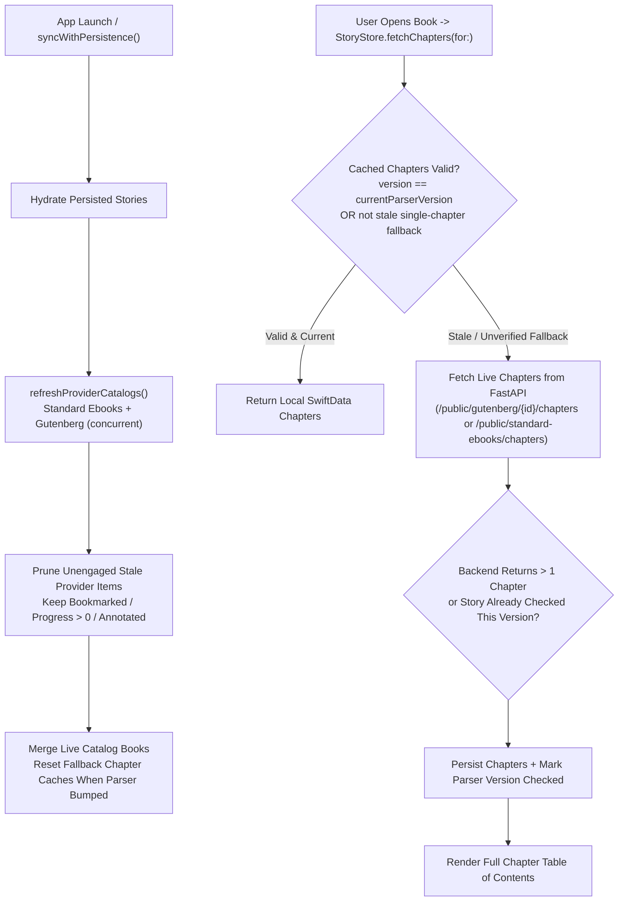

# Feature Plan 07: Multi-Chapter Catalog, Parser Edge Cases & Client Cache Remediation

**Document Version:** 1.0.0  
**Architectural Scope:** iOS SwiftData Chapter/Catalog Self-Healing, Gutenberg Unnumbered & Multi-Part Parsing, Catalog Deduplication, Standard Ebooks Heading & Timeout Polish  
**Backend Stack:** Python 3.9+ / FastAPI / Pydantic v2 / `xml.etree.ElementTree`  
**Client Stack:** Swift 5.9+ / SwiftUI / SwiftData  
**Related Context:** [`docs/DATA_SOURCES_AND_API_STRATEGY.md`](../DATA_SOURCES_AND_API_STRATEGY.md), [`docs/plans/06_SECURITY_VULNERABILITIES_AND_ARCHITECTURE_REMEDIATION.md`](./06_SECURITY_VULNERABILITIES_AND_ARCHITECTURE_REMEDIATION.md)

---

## 1. Executive Summary & Problem Context

An initial remediation resolved the primary causes behind every Project Gutenberg book appearing as a single chapter (`"Chapter I: The Complete Tale"`):
- Replaced newest-first (`-gutenberg_id`) pulp short-story browsing and Python 3.9 cross-event-loop `asyncio.Semaphore` failures in [`backend/services/gutenberg.py`](../../backend/services/gutenberg.py).
- Expanded [`backend/services/text_parser.py`](../../backend/services/text_parser.py) to match indented/centered headings, italic `_Chapter One_` spelled-out numerals, `STAVE` headers, and two-stage Roman headings without dropping chapters that mention `"Chapter "` inside prose.
- Added **Standard Ebooks** (`https://standardebooks.org`) as a structured semantic XHTML open-source catalog provider via [`backend/services/standard_ebooks.py`](../../backend/services/standard_ebooks.py), [`backend/api/v1/endpoints/standard_ebooks.py`](../../backend/api/v1/endpoints/standard_ebooks.py), [`StoryAPIService.swift`](../../frontend/FableApp/Features/Library/Services/StoryAPIService.swift), and [`StoryStore.swift`](../../frontend/FableApp/Features/Library/ViewModels/StoryStore.swift).

However, **five concrete issues remain** across the iOS local cache, edge-case Gutenberg formatting, catalog deduplication, and Standard Ebooks formatting polish that still cause stale 1-chapter experiences or rough metadata in the live app. This document specifies the exact root causes and phased fixes to resolve them cleanly.

---

## 2. Issue & Root-Cause Matrix

| ID | Area | Severity | Affected Files & Lines | Finding Summary |
|---|---|---|---|---|
| **CACHE-01** | Permanent Stale Single-Chapter SwiftData Cache | **P0 (High)** | `StoryStore.swift` (`L499–511`, `L595–612`, `L910–918`)<br>`PersistenceService.swift` (`L209–211`, `L304–330`) | `StoryStore.fetchChapters(for:)` and `syncWithPersistence()` treat any `StoryEntity.cachedChaptersData` containing readable text as permanently fresh (`hasUsableCachedChapters`). Any external book opened before the parser fix (e.g., `#79934` or `#79925`) remains stuck on its cached 1-chapter `"Chapter I: The Complete Tale"` entry on device indefinitely. |
| **CACHE-02** | Stale External Pulp Catalog Entries Remaining Pinned in Library | **P1 (High)** | `StoryStore.swift` (`L560–620`, `L815–827`, `L970–1035`) | `staleUnavailableOriginalStoryIDs` only prunes `.fableOriginal` records. Previously persisted external catalog items (`79934`, `79931`, `79930`, `79925`) stay persisted in SwiftData ahead of newly fetched Standard Ebooks and classic Gutenberg titles, and `mergePublicProseBooks` retains stale `max(chapters?.count ?? 0, book.totalChapters)` counts. |
| **PG-PARSE-01** | Unnumbered Named Chapters & Multi-Part TOCs in Top Gutenberg Books | **P1 (Medium)** | `backend/services/text_parser.py` (`L64–166`) | Live checks of the top 12 Gutenberg `topic=fiction` titles still fail on two patterns:<br>1. `GID=42` & `GID=43` (*The Strange Case of Dr. Jekyll and Mr. Hyde*) collapse to `1` chapter (~25,684 words) because chapters use unnumbered named headings (`STORY OF THE DOOR`, `SEARCH FOR MR. HYDE`, …) listed under `Contents`.<br>2. `GID=24` (*O Pioneers!*) outputs `['PART V. Alexandra', 'PART I.', 'PART II.', 'PART III.', 'PART IV.', 'PART V.']` because `'PART V. Alexandra'` leaks from the `Contents` outline (`123w`) and nested Roman chapters (`I..XII`) inside each Part are not split. |
| **PG-CAT-01** | Duplicate Catalog Editions & Raw MARC `$b` Title Artifacts | **P1 (Medium)** | `backend/services/gutenberg.py` (`L256–295`, `L337`) | Default Gutenberg `topic=fiction` returns both `GID=42` and `GID=43` for *Dr. Jekyll and Mr. Hyde*, and returns raw MARC subfield syntax in `GID=16` (`"Peter Pan : $b [Peter and Wendy]"`). |
| **SE-POLISH-01** | Standard Ebooks Heading Artifacts & Cold-Start Timeout Margin | **P2 (Low)** | `backend/services/standard_ebooks.py` (`L226–267`, `L269–325`)<br>`StoryAPIService.swift` (`L320–329`) | Standard Ebooks `<header>` concatenation joins punctuation artifacts (e.g. `'I: Jonathan Harker’s Journal.: (Kept in shorthand.)'`), leaves Unicode word-joiners (`\u2060`), and duplicates leading Roman numerals inside nested part prose (e.g. *Crime and Punishment* `Part I — I` body starting with `'I\n\nOn an exceptionally...'`). Cold uncached requests also risk tighter `URLSessionConfiguration` timeout margins if detail fetches stall. |

---

## 3. Target Self-Healing Architecture



---

## 4. Phased Remediation Specifications

### Phase 1: iOS Client Cache Self-Healing & Catalog Hygiene (`CACHE-01`, `CACHE-02`)

#### 4.1.1 Introduce Non-Destructive Chapter Parser Versioning (`StoryStore.swift`, `PersistenceService.swift`)
- **Problem:** Adding a new required field to SwiftData `@Model StoryEntity` without defaults or migration risks unnecessary schema churn; meanwhile `StoryEntity.cachedChaptersData` has no metadata about *which parser version* generated a cached 1-chapter payload.
- **Fix:**
  1. Define a static parser version constant on `StoryStore`:
     ```swift
     static let currentExternalChapterParserVersion = 2
     ```
  2. Persist a lightweight `[String: Int]` map (`storyId.uuidString -> verifiedParserVersion`) in `UserDefaults` scoped cleanly via `PersistenceService` (avoiding breaking `StoryEntity` lightweight migration while tracking per-story verification).
  3. Add a pure policy helper on `StoryStore` (easily unit-testable in `XCTest`):
     ```swift
     static func shouldInvalidateCachedChapters(
         _ chapters: [Chapter],
         sourceProvider: SourceProvider,
         verifiedParserVersion: Int
     ) -> Bool
     ```
     Return `true` when ALL of the following hold:
     - `sourceProvider == .gutenberg || sourceProvider == .standardEbooks`
     - `verifiedParserVersion < currentExternalChapterParserVersion`
     - `chapters.count <= 1` (especially if `chapters.first?.title == "Chapter I: The Complete Tale"` or `chapters.first?.wordCount ?? 0 >= 1_500`), **so multi-chapter cached books stay instant offline while any stale 1-chapter fallback is automatically refreshed once against the fixed backend**.
  4. In `StoryStore.fetchChapters(for:)`:
     - If cached chapters exist and `shouldInvalidateCachedChapters(...) == false`, return immediately.
     - Otherwise fetch live chapters from `apiService.fetchChapters(...)`; if network fetch succeeds, save the updated chapters, update `stories[idx].chapters` / `totalChapters`, and record `verifiedParserVersion = currentExternalChapterParserVersion`.
     - If offline / backend unavailable while stale cached chapters exist, fall back cleanly to the cached chapters so offline reading never breaks.
  5. Clear `chapters` during `syncWithPersistence()` hydration (`L595–598`) if `shouldInvalidateCachedChapters(...)` is true so opening the reader triggers the live refresh automatically.

#### 4.1.2 Prune Unengaged Stale External Catalog Cards (`StoryStore.swift`)
- **Problem:** Old Gutenberg items like `79934`–`79917` stored during earlier sessions remain in `SwiftData` and `StoryStore.stories` indefinitely even after the provider stops returning them.
- **Fix:**
  1. Add an engagement check on `Story` / `StoryEntity`: a book is *user-engaged* if `isBookmarked || isCompleted || progressPercent > 0 || lastReadChapterId != nil || hasSavedAnnotations(storyId)` (also `ownerUserId != nil`).
  2. Inside `fetchStandardEbooksPublicStories` and `fetchGutenbergPublicStories` **only when `topic != nil && (search ?? "").isEmpty`** (full catalog refresh, *not* targeted search or author search):
     - Let `liveProviderIDs = Set(fetched.map(\.id))`.
     - Identify previously cached stories for that same `SourceProvider` that are **not** in `liveProviderIDs` and are **not** user-engaged (`!isUserEngaged(story)`).
     - Remove them from `stories` and delete them from SwiftData via `PersistenceService.shared.deleteStory(storyId:onlyIfUnannotated: true)`.
  3. Preserve user-engaged external books untouched, keeping bookmarks, notes, highlights, and reading progress intact.

---

### Phase 2: Gutenberg Parser Edge Cases & Catalog Hygiene (`PG-PARSE-01`, `PG-CAT-01`)

#### 4.2.1 Support `Contents`-Driven Unnumbered Chapters (`GID=42`, `GID=43`) in `backend/services/text_parser.py`
- **Problem:** Books like *The Strange Case of Dr. Jekyll and Mr. Hyde* format chapters as unnumbered title lines (`STORY OF THE DOOR`, `SEARCH FOR MR. HYDE`, …, `HENRY JEKYLL’S FULL STATEMENT OF THE CASE`) listed in a `Contents` section.
- **Fix:**
  1. Add Stage 4 fallback inside `extract_chapters_from_text` (executed only when Stages 1–3 produce `< 2` chapters and `len(clean_text.split()) >= 3_000`):
     - Locate a `Contents` / `CONTENTS` / `Table of Contents` block near the top of `clean_text` (first 20% of document or 12,000 chars).
     - Extract non-empty candidate lines (`3..60` lines, `3..80` chars each) up to the next large section break, normalizing curly quotes (`’` -> `'`) and collapsing internal whitespace.
     - Verify those candidate titles sequentially against standalone heading lines (`^\s*{normalized_title}\s*$`) in the body *after* the `Contents` block.
     - Require at least `3` matched titles covering `>= 60%` of the TOC entries, each followed by `>= 50` prose characters before the next matched title.
     - Split the body at those verified heading offsets into sequential `Chapter` dicts with title-cased or original titles.

#### 4.2.2 Fix `PART I..V` TOC Leak & Nested Roman Chapter Splitting (`GID=24` *O Pioneers!*)
- **Problem:** In `GID=24`, `'PART V. Alexandra'` in the `Contents` listing (`Contents\n\n PART I. ...\n ... \n PART V. Alexandra\n\n PART I. The Wild Land\n\nI\n\n...`) matched `PART\s+[IVXLCDM]+` ahead of a blank-line threshold `< 350` words because `I..V` Roman numerals in the TOC weren't counted as TOC lines, and Roman chapters (`I`, `II`, `III`) nested inside each `PART` weren't split.
- **Fix:**
  1. Broaden `_is_toc_listing(body)` to also recognize bare standalone Roman lines (`^[ \t]*[IVXLCDM]{1,6}[ \t]*$` occurring `>= 3` times in `< 450` words) and check whether the preceding block contains `CONTENTS` / `Contents`.
  2. When Stage 1 matches top-level `PART` / `BOOK` divisions (`<= 8` sections) whose bodies each contain multiple standalone Roman numeral markers (`\n{2,}[ \t]*[IVXLCDM]{1,7}\.?[ \t]*\n{2,}` with `>= 2` subsections), subdivide each Part into `"<Part Title> — Chapter <Roman>"` using the existing Stage 3 Roman splitter so books like *O Pioneers!* yield all individual chapters instead of only 5–6 massive Part blobs.

#### 4.2.3 Clean MARC `$b` Title Artifacts & Deduplicate Editions (`backend/services/gutenberg.py`)
- **Fixes:**
  1. Add `_clean_gutenberg_title(raw_title: str) -> str` in `gutenberg.py` (used in `_gutenberg_book_from_rdf`, `_story_from_gutenberg_metadata`, and catalog search normalization) to normalize MARC subfields such as `"Peter Pan : $b [Peter and Wendy]"` → `"Peter Pan: [Peter and Wendy]"` and strip redundant `: $b` / `$b` tokens.
  2. Deduplicate matching catalog entries in `_search_gutenberg_catalog` by normalized `(clean_title.casefold(), primary_author.casefold())` (keeping the lowest-ID canonical English edition, e.g., keeping `GID=42` while skipping duplicate `GID=43` unless `search` explicitly targets an ID).

---

### Phase 3: Standard Ebooks Formatting & Reliability Polish (`SE-POLISH-01`)

#### 4.3.1 Clean Chapter Heading Punctuation, `\u2060`, and Nested Roman Headings (`backend/services/standard_ebooks.py`)
- **Fixes:**
  1. In `_clean_heading_text` / `_extract_heading_title`:
     - Replace Unicode word-joiner `"\u2060"` with `""` and strip trailing punctuation (`.:;`) between title segments before joining (turning `'I: Jonathan Harker’s Journal.: (Kept in shorthand.)'` into `'I: Jonathan Harker’s Journal (Kept in shorthand.)'`).
  2. In `_extract_prose_blocks`:
     - Notice in nested multi-part novels like *Crime and Punishment*, the child chapter's own Roman `<h3>`/`<h2>` (`"I"`) sits outside `<header>` in an `<h2>`/`<h3>` or `hgroup` sibling that may still be walked if nested deeper than direct children; skip the exact primary chapter heading element already extracted into `title` so `"Part I — I"` doesn't repeat `"I"` as its first paragraph.
  3. Normalize non-breaking spaces `\xa0` and `\u2060` cleanly (`text.replace("\u2060", "")`).

#### 4.3.2 Bound Cold-Start Detail Fetches & Align iOS Timeout Policy
- **Backend (`backend/services/standard_ebooks.py`):**
  - Keep detail metadata warm in `_STANDARD_EBOOKS_DETAIL_CACHE` (already 1h TTL) and cap per-detail fetch timeout at `8.0s` so a single slow detail page never stalls all 12 listing cards (`asyncio.Semaphore(6)` gracefully falls back to basic synopsis + `"Classics"` if any detail page times out).
- **iOS (`frontend/FableApp/Features/Library/Services/StoryAPIService.swift`):**
  - Verify all public catalog and chapter requests (`fetchPublicCatalogStories`, `fetchChapters`) use `Self.providerRequest(for:)` (which sets `request.timeoutInterval = 20.0`, overriding the default `5.0s` `URLSessionConfiguration` timeout for heavy upstream cold fetches) and add explicit fallback/logging when `fetchStandardEbooksStories` fails.

---

## 5. Verification Plan

| Layer | Verification Action | Expected Result |
|---|---|---|
| **Backend Unit Tests (`backend/test_main.py`, `test_provider_services.py`)** | Add tests covering `Contents`-based unnumbered chapters (`Jekyll & Hyde` pattern), nested `PART` + Roman subsections (`O Pioneers!` pattern), MARC `$b` title cleanup & duplicate suppression, and Standard Ebooks clean headings / non-duplicate body headings. | All `pytest` tests pass with zero regressions (`0 failed`). |
| **Live Upstream Validation (`.venv/bin/python3`)** | Parse live Gutenberg `GID=42` (*Dr. Jekyll*), `GID=24` (*O Pioneers!*), and `GID=16` (*Peter Pan*) + Standard Ebooks *Dracula* & *Crime and Punishment*. | `GID=42` splits into `10` chapters; `GID=24` drops TOC `'PART V. Alexandra'` leak and splits sub-chapters cleanly; catalog shows clean titles without `$b` or duplicates; Standard Ebooks headings have clean punctuation. |
| **iOS Unit Tests (`xcodebuild test`)** | Add XCTest coverage in `StorySummaryDecodingTests.swift` verifying `StoryStore.shouldInvalidateCachedChapters` refreshes 1-chapter unverified Gutenberg caches, preserves already-verified 1-chapter short stories and multi-chapter caches, and prunes unengaged stale catalog cards while preserving bookmarked/in-progress items. | `FableAppTests` builds and passes (`** TEST SUCCEEDED **`). |
| **Simulator / Live E2E (`http://127.0.0.1:8001`)** | Launch updated iOS app on booted simulator containing prior single-chapter cache, open Library and Reader on both Gutenberg and Standard Ebooks titles. | Stale pulp cards (`79934`–`79925`) are replaced cleanly by multi-chapter classics; opening any book shows its full Table of Contents (`Chapter 1..N`). |
