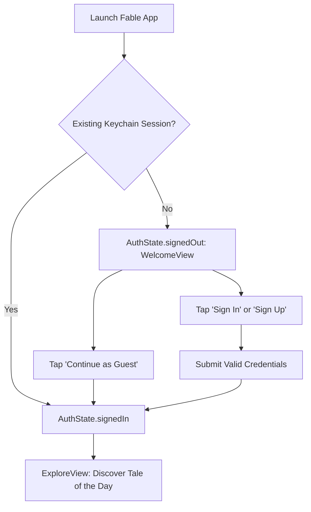
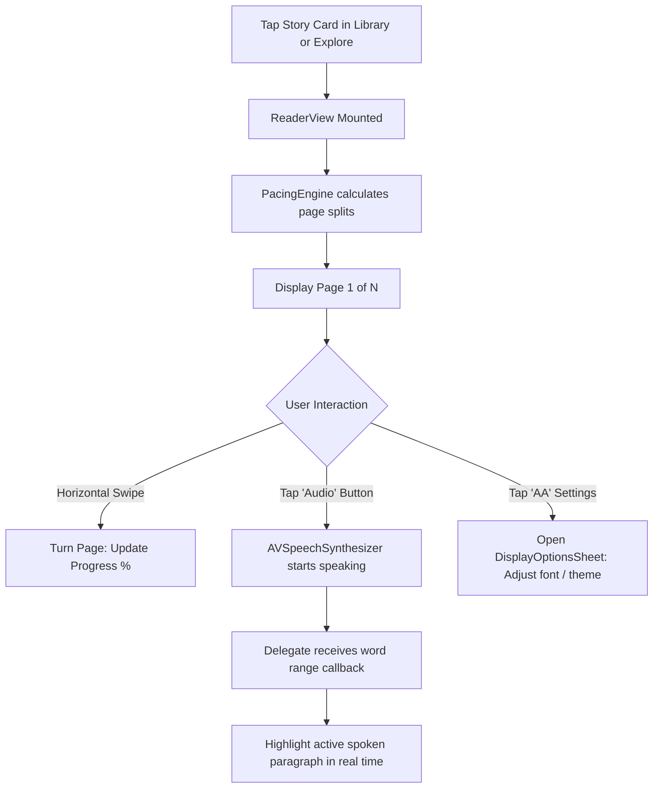
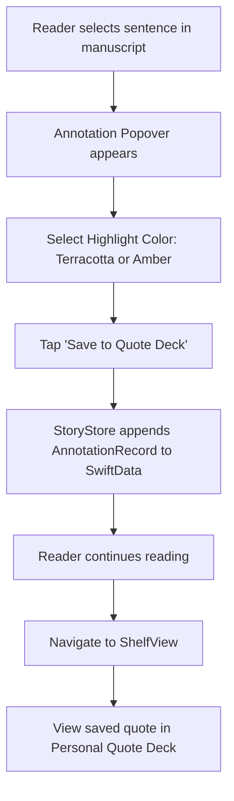
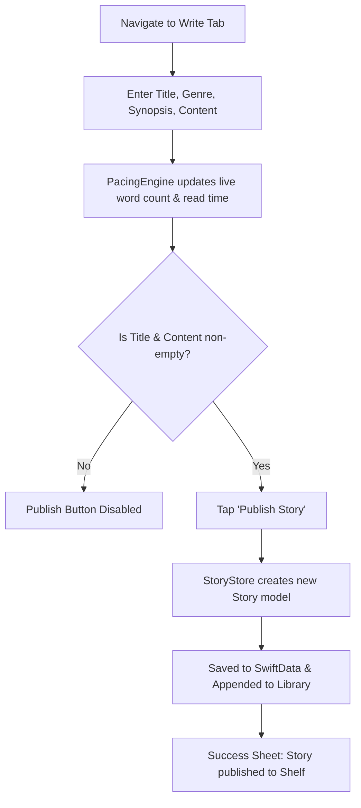
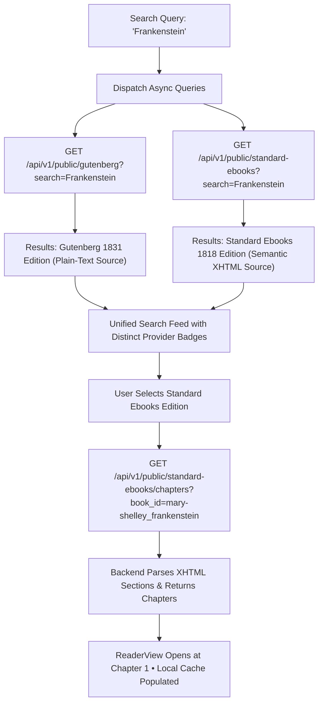

# Fable iOS: Feature Catalog & User Journey Architecture

**Document Version:** 1.1.0  
**Target Milestone:** Capstone Final Defense & Federated Multi-Provider Architecture  
**Author:** Roosc Zaño (`@zanoroosc`)  

---

## 1. Complete Functional Feature Catalog

Fable delivers a comprehensive literary ecosystem spanning federated discovery, deep reading, community writing, and personal scholarship:

```
┌───────────────────────────────────────────────────────────────────────────────────┐
│                              FABLE FEATURE ECOSYSTEM                              │
├───────────────────────┬────────────────────┬──────────────────────────────────────┤
│      DISCOVERY        │    DEEP READING    │        WRITING & SCHOLARSHIP         │
├───────────────────────┼────────────────────┼──────────────────────────────────────┤
│ • Federated Providers │ • Dynamic Paging   │ • Story Composer (WriteView)         │
│   (Standard Ebooks &  │ • 6 Reader Themes  │ • Real-Time Word Counter             │
│    Project Gutenberg) │ • Oral Audio Sync  │ • Personal Shelf Hub                 │
│ • Cross-Provider ID   │ • In-Book Search   │ • Excerpted Quote Journal            │
│ • Provider Fault Iso  │ • Offline Download │ • Markdown & Quote Card Export       │
│ • Tale of the Day     │ • Marginalia Notes │ • Live Reading Analytics             │
│ • Full-Text Search    │ • Typography HUD   │ • Multi-Device Shelf Sync            │
│                       │ • TOC & Brightness │ • Runtime Server URL Switcher        │
└───────────────────────┴────────────────────┴──────────────────────────────────────┘
```

---

## 2. Feature Deep Dive by Subsystem

### 2.1 Discovery & Editorial Curation (`ExploreView.swift` & `LibraryView.swift`)
- **Federated Multi-Provider Catalog:** Seamlessly unifies multiple literature repositories:
  - *Standard Ebooks (`STANDARD_EBOOKS`):* Typography-first public domain masterpieces with semantic XHTML chapters and rich SVG/JPEG cover art.
  - *Project Gutenberg (`GUTENBERG`):* Massive historical open-access library parsed on demand from plain-text source archives.
  - *Fable Originals (`FABLE_ORIGINAL`):* Curated editorial folklore and user-authored community manuscripts.
- **Cross-Provider Edition Disambiguation:** Works sharing identical titles across providers (e.g. Mary Shelley's *Frankenstein* or Franz Kafka's *The Metamorphosis*) retain independent deterministic UUIDv5 identifiers, provider badges, distinct chapter counts, and separate shelf progress.
- **Tale of the Day:** A prominent daily featured story card complete with procedural art, author badge, reading duration, and direct "Read Now" action.
- **Curator's Spotlight:** Highlights critical masterpieces or obscure regional folklore hand-picked for the reader.
- **Trending Writers Carousel:** Horizontal scroll showcasing historical scribes and modern community writers with calculated ratings and story counts.
- **Genre Categorization:** Dedicated genre hubs (Folklore, Mythology, Gothic, Classic Fiction, Classic Mystery) with reader metrics and rich descriptions.
- **Full-Text Live Search:** Real-time query matching filtering simultaneously across story titles, author names, and synopses with independent provider query dispatch and zero lag.

### 2.2 The Ambient Reader Experience (`ReaderView.swift`)
- **Physical Book Pagination & Continuous Scroll:** Supports both paginated physical book pages (`PacingEngine.swift`) and vertical scrolling.
- **On-Demand Chapter Hydration & One-Tap Offline Download:** Catalog metadata remains lightweight; full multi-chapter content is fetched on demand from `/api/v1/public/gutenberg/{id}/chapters` or `/api/v1/public/standard-ebooks/chapters?book_id={slug}` and cached locally for offline continuity, or downloaded in full with one tap.
- **6 Reader Themes (`ReaderTheme`) & Adaptive App Theme (`AppAppearance`):**
  - *Light Reader Themes:* **White**, **Paper**, and **Sepia** for daytime and warm-paper reading.
  - *Dark Reader Themes:* **Charcoal**, **Midnight**, and **OLED** for low-light reading, paired with app-wide **System / Light / Dark** appearance settings.
- **In-Book Full-Text Search:** Search across all chapters of the active book with contextual snippet previews and direct jump-to-passage navigation.
- **Oral Audio Storytelling:** Native text-to-speech synthesis (`AVSpeechSynthesizer`) reading aloud with synchronized visual paragraph highlights and regional `VoiceSelectionSheet`.
- **Long-Press Marginalia, Markdown Export & Quote Cards:** Long-press any passage to highlight (`Terracotta`, `Sage`, `Amber`), attach notes, pin to your personal shelf journal, export all highlights as Markdown (`.md`), or generate shareable Quote Cards (`QuoteCardView.swift`).
- **Typography & Brightness HUD (`DisplayOptionsSheet.swift`):** Real-time adjustment of font family, Dynamic Type scaling (`80%`–`150%`), line spacing, and screen brightness.

### 2.3 Community Writer Studio (`WriteView.swift`)
- **Manuscript Composer:** Clean writing canvas with title, genre dropdown, chapter tag, and synopsis fields.
- **Live Manuscript Metrics:** Dynamic word counter updating on every keystroke and calculating estimated reading time (`words / 200`).
- **Immediate Shelf Publishing:** Publishes new manuscripts directly into local state and local database storage without requiring backend provisioning.

### 2.4 Personal Shelf & Reader Analytics (`ShelfView.swift` & `ProfileView.swift`)
- **Currently Reading Shelf:** Displays active books with visual progress bars and percentage metrics.
- **Saved Bookmarks & Completed Archive:** Dedicated tabs separating in-progress readings from finished literature.
- **Excerpted Quote Journal:** Interactive card deck displaying user highlights annotated during reading, complete with story attribution.
- **Reader Analytics:** Live SwiftData-backed tracking of reading streaks (consecutive days), total minutes read, and words consumed.

### 2.5 Architectural Resilience & Fault Isolation
- **Independent Provider Ingestion:** `StoryStore` dispatches catalog queries to Project Gutenberg and Standard Ebooks independently. If an upstream provider fails or times out, the client displays an informative inline badge without crashing or hiding results from healthy providers.
- **Offline Determinism:** Previously hydrated stories and chapters remain 100% accessible in local storage even when completely disconnected from the network.

---

## 3. User Journey State Diagrams

### 3.1 Journey 1: Onboarding to Discovery


---

### 3.2 Journey 2: Deep Reading & Oral Audio Narration


---

### 3.3 Journey 3: Marginalia Quote Annotation


---

### 3.4 Journey 4: Writing & Publishing a Community Story


---

### 3.5 Journey 5: Federated Source Discovery, Edition Selection, and Fault-Tolerant Hydration


---

## 4. Defense Talking Point: "What Makes Fable's User Experience Unique?"

> *"Fable is not simply an e-reader; it is an ambient reading sanctuary. Where commercial reading apps bombard the user with paywalls, social feeds, and ads, Fable strips away digital distractions. By integrating real-time physical page turning, an on-device oral speech synthesizer that breathes life into traditional folklore, an academic marginalia quote deck, and a federated public-domain literature catalog uniting Project Gutenberg and Standard Ebooks, Fable elevates reading into a focused, reflective, and scholarship-grade experience."*
